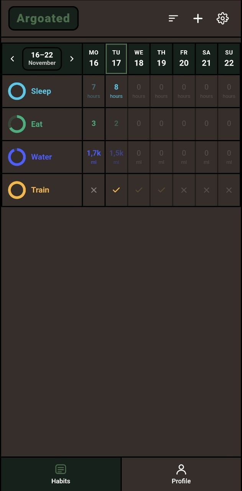
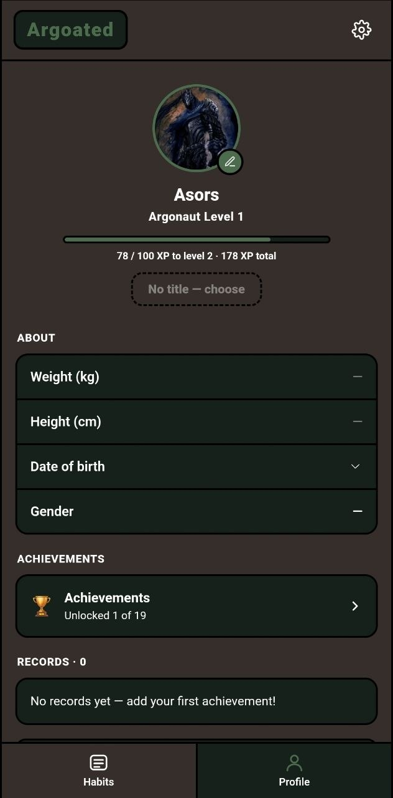

# ⛵ Argoated

**Argoated** is an offline habit tracker built as an "Argonaut's journey": XP and levels, achievements with titles, personal records, and a calendar with notes and reminders.

> 🔒 No accounts, no internet: all data is stored locally on the device.

---

## ✨ Features

### ✅ Habits

- **Two habit types**
  - *"Yes / No"* — done / not done;
  - *Measurable* — a numeric value (ml, min, km…) with a goal and a condition.
- **Flexible frequencies**: daily · every N days · N times per week · N times per month · N times in N days.
  - Auto-normalization: "every 1 day" → daily, "every 7 days" → weekly, "1 time in 1/7/30 days" → daily/weekly/monthly.
- **Usefulness**: useful / harmful / **note** (notes give no XP and don't affect streaks).
- **Per-day marking**: ✓ / ✗ / **skip** (a skip doesn't break the streak), marking of past dates (backfill), future days are protected from accidental taps.
- **Custom goal and color** for each habit (palette + arbitrary HEX).
- Views: **week** (portrait) / **month** (landscape), with swipe and arrow navigation.

### 📊 Habit Analytics
- **Period summary**: XP for the period, completion %, number of marks.
- **"Result"** (% completion) and **"History"** (raw values) charts with *week / month / year* periods.
- **Goals** for today / week / month / quarter / year with progress bars.
- **Heatmap** (GitHub-style) with scroll into the past and month labels.
- **Best streaks** and **weekday frequency**.

### 🔔 Reminders & Notifications
- Reminders matched to any frequency:
  - daily — multiple times per day;
  - weekly — weekday + time;
  - monthly — day of the month + time;
  - "every N days" — a time;
  - "N times in N days" — marking cycle days (e.g. 1 and 4 out of 5) + time.
- **Native notifications** via Capacitor `LocalNotifications`; fallback — Web Notifications / toast.
- Reminders for **calendar notes** (including yearly ones).

### 🗓 Calendar & Notes
- Monthly calendar with note-dot indicators.
- Per-day notes: text, time, **repeat every year** (birthdays, etc.), edit and delete.

### 🏅 Gamification
- **Argonaut levels**: 100 XP = 1 level, progress bar.
- **19 achievements** in 6 groups (Tenure, Absolute, Streaks, Habits, Records, Perseverance) with progress and unlock date.
- **Titles** for achievements — can be equipped / removed (shown in the profile).
- **"Absolute" streaks**: all useful goals (≥3) at 100% for N days in a row.
- XP limits to prevent cheating:

| Category  | Category limit | Per-useful limit |
|-----------|---------------:|-----------------:|
| Daily     | 100 XP         | 40 XP            |
| Weekly    | 300 XP         | 100 XP           |
| Monthly   | 500 XP        | 200 XP           |

### 🏆 Records
- Personal records (name, value, unit) with change history.
- **Record analytics**: current / first value, change, number of updates, max / min + a line chart of the history.

### 👤 Profile

- Avatar (upload, crop, round/square shape, custom border color HEX), name.
- Weight, height, date of birth (age auto-calculated), gender.
- Stats: days in the app, time in the app, level, streaks, marks.

### ⚙️ Settings
- **Languages**: Russian / English (full localization).
- **Theme**: 6 customizable colors (background, accent, surface, line, font, frame) — HEX input + picker, theme reset.
- Calendar direction **LTR/RTL**.

### 💾 Data
- Autosave, sanitization on load.
- **Backup** to JSON (format v2): in the browser — file download; in the APK — written to `Documents/` via Capacitor Filesystem.
- **Import** with format validation and a replacement confirmation.

### 🛠 Tech

- **HTML / CSS / Vanilla JS** — a single file, no runtime dependencies.
- **Capacitor** (`@capacitor/core`, `@capacitor/app`, `@capacitor/local-notifications`, `@capacitor/filesystem`) for the Android build.
- Canvas charts, CSS Grid/Flex, PWA meta (fullscreen, safe-area).

## 💖 Support the Project

**Argoated is and always will be 100% free, open-source, and ad-free.** There are no paywalls, no premium tiers, and absolutely no telemetry. I build this tool for myself and the community.

If this tracker helps you on your "Argonaut's journey" to build better habits, you can support its independent development in two simple ways:

1. **Financial Support:** [Buy me a coffee on Boosty](https://boosty.to/asors). Every contribution, no matter how small, helps keep this project alive, independent, and free from corporate influence.
2. **Community Support:** Leave a ⭐ star on [GitHub](https://github.com/as0rs/Argoated/tree/main) or share your feedback. It’s the best free way to help others discover this project!

Thank you for valuing privacy and independent development. ⛵
